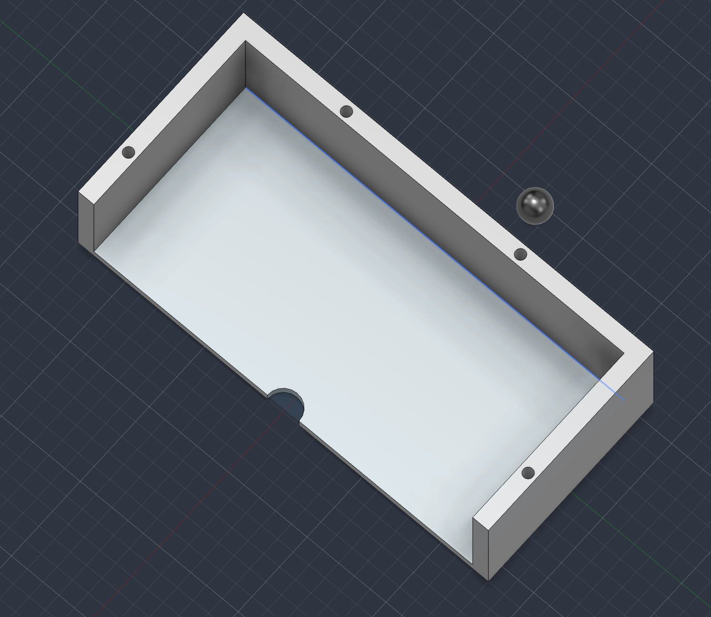

# ⚽ Interactive Soccer Goal System

An interactive soccer goal built using a **3D-printed goal**, **ESP32 microcontroller**, **HC-SR04 ultrasonic sensor**, **LEDs**, and a **vibration motor**. The system automatically detects when a soccer ball enters the goal and triggers flashing lights and haptic feedback.

## 🎥 Project Demo

## Project Overview

This was my first every 3D print and I used Fusison 360 to build out the soccer goal. The design of the soccer goal has four holes inside the posts and woodwork for leds to flash when the goal is registered. The diameter of these holes are 6mm so allow the led to fit properly all the way through the hole. And for the wires attached to the ultrasonic sensor, there is a semicircle cutout at the back of the goal to allow the wires to easily attach to the esp32. 

When the ball gets within 2 cm of the goal a goal is detected by the system. The esp32 activates the vibration motor and flashed the LEDs for five seconds before resetting for the next goal. The LED lights turn on for 0.25 seconds and turn off for 0.25 second for a 5 second period when the goal is detected. 

## Hardware Components

- **ESP32** 
- **HC-SR04 Ultrasonic Sensor** 
- **LEDs** 
- **Vibration Motor** 
- **3D-Printed Soccer Goal** 

## How It Run the Script
To run this all you have to do is run the goalDetection.ino 

